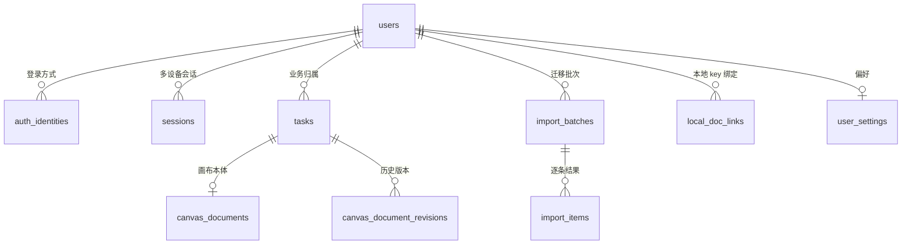

<div align="center">

# 无限任务画布 · 云端服务

**为无限画布 Dashboard 提供认证、任务管理与画布同步的一体化后端**

把散落在浏览器 `localStorage` 里的画布，安全地搬到云端，并且随时可以搬回来。

[](https://workers.cloudflare.com/)
[](https://hono.dev/)
[](https://developers.cloudflare.com/d1/)
[](https://nodejs.org/)
[](./test)
[]()

[功能特性](#功能特性) · [架构](#架构) · [快速开始](#快速开始) · [API 一览](#api-一览) · [设计取舍](#设计取舍) · [部署](#部署) · [文档](#文档)

</div>

---

## 这是什么

「无限任务画布」是一个以自由画布组织任务的产品。它的第一版把画布整份存在浏览器 `localStorage` 里——够快，但换台电脑就没了。

本项目是它的云端后端，解决三件事：

1. **账号**：邮箱密码与 GitHub 两种登录方式，挂在同一个用户下，可绑定、可解绑。
2. **同步**：任务与画布文档落到 Cloudflare D1，用 `ETag` + `If-Match` 做乐观锁，多设备不会静默覆盖。
3. **迁移**：已有本地存档可分批导入，幂等、可校验、7 天内可一键回滚。

设计上刻意做成「薄后端」：只做鉴权、校验、版本控制与迁移编排，画布渲染、冲突合并 UI、离线队列都留在前端。这样画布内部 30+ 个组件无需改动。

> [!NOTE]
> 前端未登录时继续读写 `localStorage`，登录后是「复制一份到云端 + 打标记」，原数据不原地改名。多账号共用一台电脑也不会串数据。

---

## 功能特性

| 能力 | 说明 |
| --- | --- |
| 双层身份模型 | `users` 描述「人」，`auth_identities` 描述「登录方式」；新增 provider 只扩白名单，解绑只是删一行 |
| 邮箱认证 | 注册强制验证邮箱、找回密码、重发冷却、常见弱口令拦截；PBKDF2-HMAC-SHA256（600k 迭代） |
| GitHub OAuth | `state` 防 CSRF、`client_secret` 只存在 Worker；已验证邮箱可自动合并，未验证邮箱拒绝接管 |
| 会话安全 | `__Host-session` HttpOnly Cookie，服务端只存 `sha256(token)`；绝对 30 天 + 滑动 7 天 |
| 登录限流 | 邮箱桶 + IP 桶，15 分钟窗口内 5 次失败即锁定，返回 `Retry-After` |
| 任务管理 | 增删改查、软删除、按分类/状态筛选、标题搜索、keyset 分页（游标不可伪造） |
| 画布文档 | 整份 JSON 落库，`ETag` 条件请求、`If-Match` 乐观锁、`content_hash` 幂等、1.5 MB 体积上限 |
| 数据迁移 | 每批 ≤ 20 条、单条失败不阻断整批、`local_doc_links` 保证幂等、7 天回滚窗口 |
| 安全基线 | Origin 白名单、同源校验、`X-Request-Id`、安全响应头、5xx 不泄漏堆栈、越权统一 404 |
| 可观测 | `/api/health` 检查 D1 绑定，结构化日志，请求级追踪 |

---

## 架构

```
Dashboard 前端
   │  credentials: 'include'
   ▼
┌───────────────────────────────────────────────────────────────┐
│ Cloudflare Workers                                            │
│                                                               │
│  中间件链（顺序即安全边界）                                    │
│  RequestContext → CORS → 安全头 → 同源校验 → D1 上下文 → 会话 │
│                                                               │
│  Hono 路由   /health  /auth  /me  /tasks  /migrate            │
│      │                                                        │
│  Service 业务层   auth · session · github · task · document    │
│      │                                                        │
│  Repository 数据访问   所有 SQL 强制携带 owner_id              │
└──────┬──────────────────────────────┬──────────────────────────┘
       │                              │
       ▼                              ▼
  Cloudflare D1                  GitHub OAuth / 邮件通道
  (SQLite)                       console · Resend · MailChannels
```

分层职责：

| 层 | 位置 | 职责 |
| --- | --- | --- |
| 组合根 | [`src/app.js`](./src/app.js) | 中间件顺序、路由挂载、统一错误处理 |
| 路由 | [`src/routes/`](./src/routes) | 只做参数校验与分发，不写业务 |
| 控制器 | [`src/controllers/`](./src/controllers) | HTTP 语义 ↔ 业务调用 |
| 服务 | [`src/services/`](./src/services) | 认证、会话、OAuth、文档、迁移编排 |
| 仓储 | [`src/repositories/`](./src/repositories) | 唯一允许出现 SQL 的地方 |
| 工具 | [`src/lib/`](./src/lib) | 密码、Cookie、校验、序列化、分页、UUIDv7 |

### 数据模型



关键约束：

- `UNIQUE(provider, provider_user_id)`：同一个 GitHub 身份不会指向两个账号。
- `tasks` 使用 `(owner_id, id)` 复合外键，文档表冗余 `owner_id`，应用层写错也挂不到别人任务上。
- `canvas_documents.revision` 是乐观锁版本号，`content_hash` 让重复提交直接跳过。
- `local_doc_links` 主键 `(user_id, local_key)`：同一份本地存档导入两次不会产生第二个任务。

完整 DDL 见 [`docs/sql/0001_init.sql`](./docs/sql/0001_init.sql)。

---

## 快速开始

### 环境要求

- Node.js >= 20
- npm
- Cloudflare 账号（仅部署时需要）

### 本地运行

```bash
npm install

# 本地密钥
cp .dev.vars.example .dev.vars
# Windows PowerShell: Copy-Item .dev.vars.example .dev.vars

# 初始化本地 D1
npm run db:init:local

# 启动（默认 http://localhost:8787）
npm run dev
```

验证：

```bash
curl http://localhost:8787/api/health
```

```json
{ "ok": true, "database": "ok", "time": "2026-10-28T08:00:00.000Z" }
```

`database` 为 `unavailable` 表示没有绑定 D1，先执行 `npm run db:init:local`。

### 第一个账号

```bash
curl -X POST http://localhost:8787/api/auth/register \
  -H 'Content-Type: application/json' \
  -d '{"email":"user@example.com","password":"S3cure-passw0rd","displayName":"小伍"}'
```

开发环境（`EMAIL_PROVIDER=console`）不会真正发信，响应里会带 `verification.devToken`，直接调用 `POST /api/auth/verify-email` 完成验证即可登录。

### 常用脚本

| 命令 | 作用 |
| --- | --- |
| `npm run dev` | 启动本地 Worker |
| `npm run test` | Vitest（10 个文件 / 42 个用例） |
| `npm run lint` | ESLint |
| `npm run format` | Prettier 格式化 |
| `npm run build` | `wrangler deploy --dry-run` 打包校验 |
| `npm run check` | lint + test |
| `npm run db:init:local` | 初始化本地 D1 |
| `npm run db:init` | 初始化线上 D1 |
| `npm run deploy` | 发布到 Cloudflare |

---

## 环境变量

`wrangler.toml` 的 `[vars]` 提供普通配置，`wrangler secret put` 提供密钥。空字符串一律视为「未配置」。

| 变量 | 必填 | 默认值 | 说明 |
| --- | --- | --- | --- |
| `ENVIRONMENT` | 否 | `development` | `production` 时启用 HSTS、Secure Cookie |
| `APP_ORIGIN` | 推荐 | `http://localhost:5173` | 前端地址；用于 CORS、OAuth 回跳、邮件链接 |
| `ALLOWED_ORIGINS` | 否 | 空 | 额外跨域来源，逗号分隔 |
| `PBKDF2_ITERATIONS` | 否 | `600000` | 密码哈希迭代次数；超出 CPU 限额可降到 `210000` |
| `EMAIL_PROVIDER` | 否 | `console` | `console` / `resend` / `mailchannels` |
| `EMAIL_FROM` | 否 | `no-reply@example.com` | 发件人 |
| `GITHUB_CLIENT_ID` | GitHub 登录必填 | 空 | OAuth App Client ID |
| `GITHUB_CLIENT_SECRET` | GitHub 登录必填 | 空 | **Secret**，不要提交到仓库 |
| `GITHUB_REDIRECT_URI` | 推荐 | 空 | 必须与 GitHub OAuth App 回调地址一致 |
| `RESEND_API_KEY` | `resend` 通道必填 | 空 | **Secret** |
| `IP_HASH_SALT` | 否 | 回退到 `GITHUB_CLIENT_SECRET` | IP 哈希盐，建议单独配置 |
| `SESSION_COOKIE_NAME` | 否 | `__Host-session` | 非 `__Host-` 前缀时，非生产环境放宽 Secure |

线上写入密钥：

```bash
npx wrangler secret put GITHUB_CLIENT_SECRET
npx wrangler secret put RESEND_API_KEY
npx wrangler secret put IP_HASH_SALT
```

---

## API 一览

所有接口位于 `/api` 下。需要登录的接口使用 HttpOnly Cookie 会话，前端请求必须带 `credentials: 'include'`。

| 分组 | 接口 | 说明 |
| --- | --- | --- |
| 健康 | `GET /api/health` | 健康检查，不依赖 D1 绑定 |
| 认证 | `POST /api/auth/register`、`POST /api/auth/login`、`POST /api/auth/logout`、`GET /api/auth/session` | 注册、登录、登出、查询会话 |
| 邮箱 | `POST /api/auth/verify-email` `/resend-verification` `/forgot-password` `/reset-password` | 验证与找回 |
| 身份 | `DELETE /api/auth/identities/:id` | 解绑登录方式（保留最后一种） |
| OAuth | `GET /api/auth/github/start` `/callback`、`POST /api/auth/github/link` | GitHub 登录与绑定 |
| 用户 | `GET /api/me` | 用户资料与已绑身份 |
| 任务 | `GET/POST /api/tasks`、`PATCH/DELETE /api/tasks/:id` | 列表、创建、更新、软删除 |
| 画布 | `GET/PUT /api/tasks/:id/document` | 条件读取与乐观锁保存 |
| 迁移 | `POST /api/migrate/import`、`POST /api/migrate/rollback/:batchId` | 导入本地存档、回滚批次 |

<details>
<summary><b>完整接口清单</b></summary>

```text
GET    /api/health
POST   /api/auth/register
POST   /api/auth/login
POST   /api/auth/logout
GET    /api/auth/session
POST   /api/auth/verify-email
POST   /api/auth/resend-verification
POST   /api/auth/forgot-password
POST   /api/auth/reset-password
DELETE /api/auth/identities/:id
GET    /api/auth/github/start
POST   /api/auth/github/link
GET    /api/auth/github/callback
GET    /api/me
GET    /api/tasks
POST   /api/tasks
PATCH  /api/tasks/:id
DELETE /api/tasks/:id
GET    /api/tasks/:id/document
PUT    /api/tasks/:id/document
POST   /api/migrate/import
POST   /api/migrate/rollback/:batchId
```

</details>

### 前端接入最小示例

```js
const API_BASE = 'http://localhost:8787';

export async function api(path, { method = 'GET', body, headers = {} } = {}) {
  const response = await fetch(`${API_BASE}${path}`, {
    method,
    credentials: 'include',
    headers: {
      ...(body ? { 'Content-Type': 'application/json' } : {}),
      ...headers,
    },
    body: body ? JSON.stringify(body) : undefined,
  });

  if (response.status === 204 || response.status === 304) return null;

  const payload = await response.json().catch(() => null);
  if (!response.ok) {
    const error = new Error(payload?.error?.message ?? `HTTP ${response.status}`);
    error.status = response.status;
    error.code = payload?.error?.code;
    error.details = payload?.error?.details;
    throw error;
  }
  return payload;
}
```

画布保存依赖版本号：

```js
// 读取时记住 ETag（形如 "3"），保存时原样带回
await api(`/api/tasks/${taskId}/document`, {
  method: 'PUT',
  headers: { 'If-Match': `"${revision}"` },
  body: document,
});
```

版本过期返回 `409 REVISION_CONFLICT`，`details.document` 就是服务端最新版本，交给前端合并。

完整的字段、错误码与示例见 [`docs/api.md`](./docs/api.md)。

---

## 设计取舍

这几个决定是刻意做的，评审时优先看：

| 决定 | 原因 |
| --- | --- |
| **画布按整份 JSON 存，不拆节点行** | 前端本来就是整篇读、整篇写；拆表会把一次 `UPDATE` 变成几十次，且当前没有「按节点查询」需求 |
| **会话只存 token 哈希** | D1 泄露时攻击者拿到的是 `sha256(token)`，无法直接冒用 |
| **匿名数据不原地升级** | 登录只是复制到云端，本地 key 不动；多账号共用电脑时不会互相污染 |
| **冲突宁可弹窗，不 last-write-wins** | 画布常长时间离线编辑，静默覆盖等于随机删除另一台设备的工作 |
| **迁移输的一方一定留档** | 迁移是单向操作，任何静默丢弃都不可接受；`import_items` + `revisions` 双保险 |
| **只存业务必需数据** | GitHub `access_token` 首版不落库，减少加密轮换与泄露面 |

---

## 项目结构

```text
.
├── src/
│   ├── index.js                  # Worker 入口，只导出 fetch handler
│   ├── app.js                    # 组合根：中间件顺序 = 安全边界
│   ├── config/
│   │   ├── constants.js          # 会话、限流、体积、枚举等全局常量
│   │   └── env.js                # 环境绑定 → 不可变配置对象
│   ├── middleware/
│   │   ├── request-context.js    # 请求 ID 与日志上下文
│   │   ├── cors.js               # 白名单 + 预检
│   │   ├── security.js           # 安全头与同源校验
│   │   ├── database.js           # D1 绑定与仓储注入
│   │   ├── session.js            # Cookie 会话解析与续期
│   │   ├── validate.js           # Zod 请求校验
│   │   └── error-handler.js      # 统一错误结构与 404
│   ├── routes/                   # 路由表
│   ├── controllers/              # HTTP 适配
│   ├── services/                 # 业务编排
│   │   └── migration/            # 单条存档导入决策
│   ├── repositories/             # 数据访问（唯一 SQL 出口）
│   └── lib/                      # 密码、Cookie、OAuth、文档、分页等工具
├── test/                         # Vitest：10 个文件 / 42 个用例
├── docs/
│   ├── api.md                    # 接口文档
│   ├── cloud-auth-and-storage-design.md
│   └── sql/0001_init.sql         # D1 初始化脚本
├── wrangler.toml                 # Worker 与 D1 绑定
└── eslint.config.js
```

---

## 质量保障

```bash
npm run check   # ESLint + Vitest
npm run build   # wrangler dry-run，确认可打包
```

当前状态：**10 个测试文件 / 42 个用例全部通过**。测试覆盖 Cookie、密码哈希、文档规范化、校验、分页、时间处理、UUIDv7、HTTP 与错误结构。

提交前建议本地再跑一遍 `npm run check`。

---

## 部署

1. 创建 D1 并把 `database_id` 填进 `wrangler.toml`：

   ```bash
   npx wrangler d1 create unbounded-task-canvas
   ```

2. 修改 `wrangler.toml`：

   ```toml
   [vars]
   ENVIRONMENT = "production"
   APP_ORIGIN = "https://canvas.example.com"
   ALLOWED_ORIGINS = ""
   EMAIL_PROVIDER = "resend"
   GITHUB_REDIRECT_URI = "https://api.example.com/api/auth/github/callback"
   ```

3. 写入密钥：

   ```bash
   npx wrangler secret put GITHUB_CLIENT_SECRET
   npx wrangler secret put RESEND_API_KEY
   npx wrangler secret put IP_HASH_SALT
   ```

4. 初始化线上库并发布：

   ```bash
   npm run db:init
   npm run build
   npm run deploy
   ```

5. 发布后验证：

   ```bash
   curl https://<worker-domain>/api/health
   ```

期望返回 `database: "ok"`。

> [!TIP]
> 本地所有请求共用 `127.0.0.1`，登录测试很容易触发 IP 限流。清空计数：
> `npx wrangler d1 execute unbounded-task-canvas --local --command "DELETE FROM login_attempts;"`

---

## 路线图

- [x] 邮箱注册 / 登录 / 验证 / 重置
- [x] GitHub OAuth 登录、绑定与解绑
- [x] 任务 CRUD、筛选、keyset 分页
- [x] 画布文档 `ETag` + `If-Match` 乐观锁与幂等保存
- [x] 本地存档迁移、幂等导入、批次回滚
- [x] 请求追踪、安全头、统一错误结构
- [ ] 超过 1.5 MB 的画布下沉 R2（行内保留指针）
- [ ] 标题全文检索（D1 FTS5）
- [ ] Durable Object 实时协作
- [ ] Passkey / 微信登录等新 provider

---

## 贡献

1. 从 `main` 拉出功能分支。
2. 保持分层：SQL 只写在 `src/repositories/`，业务只写在 `src/services/`。
3. 提交前执行 `npm run check`。
4. PR 描述里写清动机、行为变化与验证方式。

新增接口时请同步更新 [`docs/api.md`](./docs/api.md)；改表结构时新增迁移脚本，不要修改已发布的 `0001_init.sql`。

---

## 文档

| 文档 | 内容 |
| --- | --- |
| [接口文档](./docs/api.md) | 全部接口、字段约束、错误码、前端接入示例 |
| [认证与存储设计](./docs/cloud-auth-and-storage-design.md) | 身份模型、表结构、双模存储、迁移冲突矩阵 |
| [数据库初始化](./docs/sql/0001_init.sql) | D1 DDL、索引与约束 |

---

## 📄 许可证

本项目基于 [MIT](LICENSE) 许可证开源。

---

<div align="center">

如果这个项目对你有帮助，欢迎点一个 ⭐ 支持一下！

</div>
